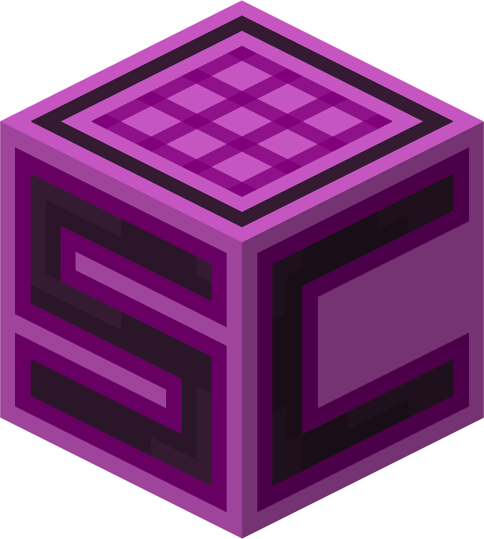

# Scerite 
Manage local and remote Minecraft servers from one desktop application. Install Minecraft versions, loaders, mods and plugins, configure servers, and access their consoles without requiring a separate management panel on your remote machine.

Scerite is a cross-platform desktop app for managing local and remote Minecraft servers. The desktop app is built with Tauri 2, React, TypeScript, and Rust.

## Architecture

- `src/` contains the React interface. `src/lib/serverProfiles.ts` is the frontend API boundary for server profile commands.
- `src-tauri/src/lib.rs` initializes Tauri state and registers commands.
- `src-tauri/src/server_profiles/model.rs` defines the shared Rust profile and target types.
- `src-tauri/src/server_profiles/commands.rs` exposes profile actions to the frontend.
- `src-tauri/src/server_profiles/store.rs` validates and persists profiles in the app data directory. It writes a temporary file and keeps a recoverable backup while replacing saved data.
- Minecraft process management, local filesystem access, remote SSH/SFTP/tmux operations, and server software installation are handled in Rust.

Profile data contains server names, local or remote server folders, launch commands, and remote SSH connection details. It does not contain passwords or private keys. Remote authentication uses the SSH agent or an optional private-key file path; encrypted keys must be unlocked through the agent. Host keys are checked against the user's `known_hosts` file.

## Current scope

The app can create, edit, list, and remove server profiles. Local servers can be launched in sessions that survive the desktop app, with a live console and a guarded file editor. Remote Linux profiles can use SSH to manage persistent `tmux` sessions, send console commands, and browse or edit files over SFTP.

Remote process control requires `tmux` on the server and a trusted host key in `known_hosts`. If a remote server exits, its last console output remains available until the next start. Remote file operations stay inside the configured server folder, skip symbolic links, limit text files to 1 MB, and require the managed server to be stopped before writing.

When adding a remote server, Scerite creates the configured Minecraft root if needed, then creates or reuses `<environment root>/servers/<server-name>`. An existing custom server folder can still be selected instead. Renaming a stopped server also renames its folder, locally or over SSH. If the new folder name already exists, the rename is refused.

The first tab on a server page shows its status, player count, address, software, version, and server-process CPU and RAM use. Player counts come from the Minecraft status response, so they may be unavailable when the server is starting or cannot be reached.

## Performance

| Metric | Measurement |
|---|---|
| Executable size | ~10 MB |
| Startup time | ~200 ms |
| Memory usage | ~90 MB |

Measured on Windows 11. Memory usage represents the combined private working set of Scerite and its WebView2 subprocesses while idle. Results may vary by system and workload.
## Server software installation

Set one Minecraft root for this computer, or a root for each remote environment. Each selected server folder must be directly inside that root's `servers/` folder. From the server's **Install** tab, choose a Minecraft release or snapshot and server software: Vanilla, Paper, Purpur, Fabric, Quilt, Forge, NeoForge, or an available Arclight Forge/NeoForge/Fabric variant. Availability depends on what each project publishes for the selected Minecraft version. Spigot installation is planned for later.

Vanilla jars are verified against Mojang's SHA-1 checksum and cached at `cache/minecraft/<version>/server.jar`. Other direct jars are cached by software, Minecraft version, and build, then copied into the server folder without replacing an existing jar. Forge, NeoForge, and Quilt use their upstream installers and require an empty server folder. A failed installer may leave partial files there; inspect or remove them before retrying. Remote installation uses SFTP and standard Linux commands without a custom agent. The server must be stopped for any installation.

The installer reads the required Java major version from Mojang's release metadata and installs a matching Eclipse Temurin JDK under `runtimes/java/<major>/<platform>/<build>/`. JDK archives are SHA-256 verified, used temporarily during local or remote installation, then removed. The next Java installation or selection removes the old `cache/java/` folder for that local root or remote environment. Standard Java launch profiles are updated for the installed software. Custom launch executables are preserved and may need manual editing. Remote Java installation requires Linux `sha256sum`, `tar`, `mv`, and `rm`.

## Mods and plugins

The **Mods & plugins** tab lists JAR files in the selected server's `mods/` or `plugins/` folder. Enter the server's Minecraft version and loader, then search Modrinth for compatible server packages. Select a published release to download and install its primary JAR and required dependencies. Downloads are checked against Modrinth's SHA-512 checksum and never replace an existing file. The server must be stopped. The tab supports local and remote Linux servers.

Plugins installed through Modrinth can be updated to another compatible release or removed from the installed list. Updates verify the new JAR before removing the previous one. Removal checks the installed JAR against its published checksum and refuses to remove plugins still required by another installed plugin. Untracked JARs remain visible but have no update or removal controls.

## Development

- `npm run tauri dev` starts the desktop app.
- `npm run build` type-checks TypeScript and builds the frontend.
- `cargo check --manifest-path src-tauri/Cargo.toml` checks the Rust backend.

## Desktop updates

Installed desktop builds check the latest published GitHub release on startup. When a newer version is available, Scerite asks before downloading and installing it. Development builds do not check for updates.
Merging a pull request into `main` runs the release workflow. The workflow moves **Unreleased** in [CHANGELOG.md](CHANGELOG.md) into the new version, builds signed updater artifacts for Windows, Linux, and macOS, and publishes the release with `latest.json`.

## License

Scerite is licensed under the [MIT License](LICENSE).

Copyright (c) 2026 Khayal Alizada

## Disclaimer

NOT AN OFFICIAL MINECRAFT PRODUCT. NOT APPROVED BY OR ASSOCIATED WITH MOJANG STUDIOS OR MICROSOFT.
